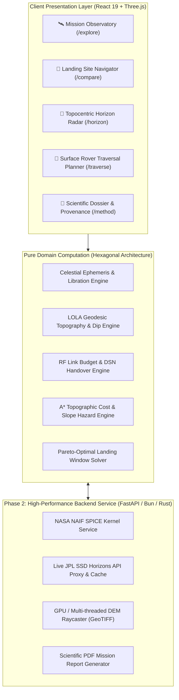
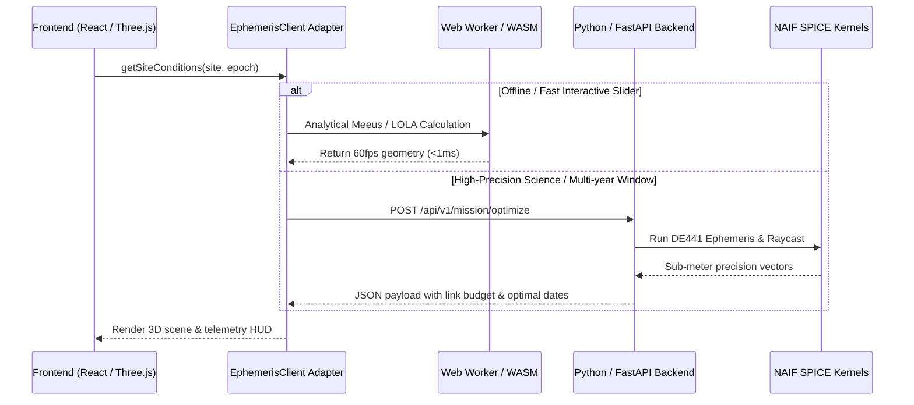
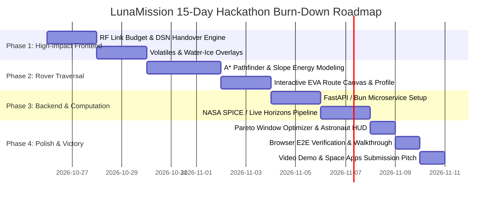

# LunaMission — Championship Masterplan & Hackathon Roadmap

**Challenge:** NASA Space Apps Challenge 2026 — *Lunar Landing Site Navigator*  
**Timeline:** 15 Days to Final Submission  
**Target:** Global Nominee & Grand Prize Winner Tier  
**Document:** Master Engineering & Product Plan (`Plan.md`)  
**Status:** Living Engineering Plan & Roadmap  

---

## 1. Executive Summary & Winning Vision

### The Challenge Statement
NASA and international space agencies face extreme environmental bottlenecks in the Lunar South Pole:
- Solar grazing incidence angles ($\le 1.5^\circ$) casting tens-of-kilometers-long dynamic shadows.
- Lunar optical libration ($\pm 6.7^\circ$ in latitude, $\pm 7.9^\circ$ in longitude) causing Earth to bob near the local horizon, dipping behind crater rims and severing communication links.
- Water ice cold traps ($\le 110\text{ K}$) sequestered deep inside permanently shadowed regions (PSRs) flanked by steep, hazardous crater scarps ($>25^\circ$).

### The Winning Vision
Most hackathon projects will present simple 2D static maps or generic 3D globes with mock coordinates.  
**LunaMission** will be the **definitive, aerospace-grade lunar mission architecture platform**:
backed by real **NASA LOLA altimetry (128ppd / 20m DEM)**, **analytical JPL/Meeus orbital mechanics**, an **integrated RF communication link budget engine**, a **rover EVA traversal planner**, and an **authoritative 20-site multi-tier catalog**.

---

## 2. In-Depth Gap Analysis: Where We Stand & What We Need

We conducted an exhaustive audit of our current implementation against the criteria of top NASA Space Apps Grand Prize projects.

| Engineering Domain | Current Implementation (What Works Now) | The Gap (What's Missing) | Strategic Upgrade (How We Win) |
|---|---|---|---|
| **Site Scope & Catalog** | 20 sites across 4 tiers (Artemis III 9 regions, Polar benchmarks, CLPS landers, Historic baselines). | Custom point entry is limited to 2D map clicks; no custom site persistence or user-defined landing target comparison. | **Custom Landing Target Studio**: Enter arbitrary (Lat, Lon, Elev) or click 3D Moon to generate instantaneous full-mission analysis and compare against Artemis candidates. |
| **Communication & DTE** | Binary geometric visibility (`visible` / `sub-horizon`) and theoretical light-time (seconds). | No realistic Radio Frequency (RF) link budget, path loss, carrier frequency (X-band/Ka-band), or DSN ground station tracking. | **NASA Deep Space Network (DSN) & RF Link Budget Engine**: Calculate link margin (dB), path loss, signal-to-noise ratio, and live ground station tracking (Goldstone, Madrid, Canberra). |
| **Surface Traversal & Mobility** | 48-point LOLA ridge transects with slope safety classifications. Rover first-person drive mode. | No multi-kilometer path planning from lander to PSR ice deposits; no slope energy expenditure model. | **Rover Traversal & EVA Route Planner**: Interactive A* pathfinder from landing site to crater cold trap with slope energy penalty, hazard avoidance, and communication shadow mapping. |
| **Resources & Volatiles** | Static text summary in Site Intel panel (WEH wt%, Diviner temperatures). | No visual spatial overlays for volatile cold traps, neutron suppression, or thermal contours. | **Multi-Spectral Planetary Layer Studio**: Toggle real LEND hydrogen suppression, Diviner surface temperature heatmaps, and ShadowCam albedo overlays on the 3D globe. |
| **Temporal Mission Planning** | 14-day landing window metrics, 1Hz live ticking clock, stepping controls. | User must manually pick dates; no automated multi-month optimizer finding the best launch dates. | **Pareto-Optimal Landing Window Solver**: Multi-year automated solver calculating the mathematical "sweet spot" date that maximizes daylight and DTE link margin. |
| **Backend & Computing Architecture** | 100% client-side TypeScript in browser. 0ms latency, works offline. | Complex 3D DEM raycasting and SPICE kernel parsing is CPU-intensive if expanded to full 20m global GeoTIFFs. | **Hybrid Backend Architecture**: Client-side remains fast and offline-ready; optional Python FastAPI / Bun backend provides SPICE kernel calculations, GeoTIFF streaming, and PDF briefing exports. |

---

## 3. "Going Beyond": Championship-Tier Winning Features

To secure a **Global NASA Space Apps Championship**, the project must transcend standard expectations and deliver features that make judges say: *"This is a real tool NASA mission teams could use."*

### Feature 1: NASA Deep Space Network (DSN) & RF Link Budget Engine
- **Why it matters:** In deep space missions, line of sight is meaningless without an RF link budget. The Moon’s distance ($384,400\text{ km}$) produces $\sim 200\text{ dB}$ free-space path loss in X-band ($8.4\text{ GHz}$).
- **Implementation:**
  - **Free Space Path Loss (FSPL):**
    $$FSPL\text{ (dB)} = 20 \log_{10}(d) + 20 \log_{10}(f) + 92.45$$
  - **Antenna Gimbal Elevation Angle:** Calculates required high-gain antenna (HGA) elevation relative to local terrain. Flags multipath interference when Earth is $<2^\circ$ above the crater rim.
  - **DSN Station Handover Tracker:** Shows which Earth antenna is currently in line-of-sight:
    - 🇺🇸 Goldstone (California, 70m DSS-14)
    - 🇪🇸 Madrid (Spain, 70m DSS-63)
    - 🇦🇺 Canberra (Australia, 70m DSS-43)
  - Real-time indicator of the Earth's diurnal rotation showing active ground station handoffs.

### Feature 2: Rover Traversal & EVA Route Planner (Lander to PSR)
- **Why it matters:** Artemis astronauts and VIPER-class rovers cannot land directly inside permanently shadowed craters due to severe cold ($40\text{ K}$) and solar panel starvation. They must land on illuminated rim plateaus and traverse into the crater.
- **Implementation:**
  - Select landing origin (e.g. Mons Mouton or Shackleton Rim) and destination target (e.g. deep crater floor PSR).
  - Evaluates slope gradient mesh:
    - Safe: $<10^\circ$ (Green)
    - Caution: $10^\circ - 15^\circ$ (Amber)
    - Hazard: $>15^\circ$ (Red, untraversable)
  - Computes A* optimal path that minimizes battery power consumption and rover roll/pitch risk.
  - Generates live elevation profile and communication line-of-sight back to the lander/Earth along the traverse!

### Feature 3: Volatile Water-Ice Prospecting Engine (LEND & ShadowCam)
- **Why it matters:** In-Situ Resource Utilization (ISRU) water ice is the core reason Artemis is going to the South Pole.
- **Implementation:**
  - Layer overlay on 3D Globe & 2D Map:
    - LRO LEND Epithermal Neutron Suppression flux (indicating hydrogen wt%).
    - LRO Diviner surface temperature contours ($<110\text{ K}$ permanent cold traps vs $>200\text{ K}$ seasonal areas).
    - Water equivalent hydrogen (WEH) estimated yield calculator ($kg\text{ H}_2\text{O} / m^3\text{ regolith}$).

### Feature 4: Pareto-Optimal Landing Window Solver
- **Why it matters:** Mission planners need to pick launch dates years in advance. Manually clicking through days is impossible.
- **Implementation:**
  - User defines mission parameters:
    - Target Year Range: 2026 to 2028
    - Surface Stay Duration: 7, 14, or 28 days
    - Minimum Sunlight Required: $>70\%$
    - Maximum Continuous Shadow Allowed: $<48\text{ hours}$
    - Minimum Earth Elevation: $>2.0^\circ$
  - The engine sweeps the temporal parameter space, scoring each candidate site and outputting the top 3 optimal launch windows with a ranked feasibility matrix.

### Feature 5: Astronaut Helmet HUD & First-Person Surface EVA (WebXR Ready)
- **Why it matters:** Visual emotional impact for hackathon judges and the public.
- **Implementation:**
  - Ground-level first-person perspective at the landing site.
  - Realistic blinding grazing solar glare (simulated with our GPU UnrealBloomPass).
  - Earth hanging majestically above the razor-sharp black rim silhouette.
  - Astronaut helmet visor HUD displaying coordinates, pitch/roll, solar elevation, battery %, and DTE signal strength.

---

## 4. Backend Architecture & Computational Migration Roadmap

The user correctly observed: *"we need backend later, we not rely on frontend... for hackathon we have 15 days, we do backend for calculations because frontend is not good for heavy calculations, for now we work in frontend also, backend do later!"*

### Why We Decouple via Clean Hexagonal Architecture (Domain Ports & Adapters)
Our current codebase is already built on clean domain separation (`src/domain/` has zero React/DOM dependencies).  
This allows us to transition calculations from browser TypeScript to a dedicated backend **without rewriting any business logic or UI components**:

### Proposed Backend Tech Stack (To Implement in Days 8–11):
- **Framework:** Python FastAPI (lightweight, async, high-performance) or Bun HTTP.
- **Planetary Science Libraries:**
  - `spiceypy` (Python wrapper for NASA NAIF C-SPICE Toolkit)
  - `rasterio` / `gdal` (for reading NASA PDS GeoTIFF LOLA 20m altimetry tiles)
  - `numpy` / `scipy` (for multi-threaded raycasting and terrain horizon line-of-sight)
- **Caching Layer:** Redis or in-memory LRU cache for pre-computed topocentric profiles.
- **Containerization:** Docker container with one-click deployment (`docker compose up`).

---

## 5. Phase-by-Phase 15-Day Execution Timeline

### Detailed Schedule:

#### Days 1–3: Advanced Space Systems Engineering (Frontend)
- **Day 1:** Build the **RF Link Budget & NASA Deep Space Network (DSN) Engine** (`src/domain/telecom/`).
  - Calculate free space path loss, link margin (dB), and live Goldstone/Madrid/Canberra tracking.
- **Day 2:** Integrate **Volatile Cold Trap & Water-Ice Prospecting Layer** (LEND neutron suppression + Diviner cryogenic isotherms).
- **Day 3:** Build **Custom Landing Target Studio** (pin arbitrary coordinates anywhere on the Moon, evaluate LOLA slope & Sun/Earth clearance).

#### Days 4–6: Surface Rover Traversal & EVA Planning
- **Day 4:** Develop **A* Topographic Cost Pathfinder** taking LOLA DEM gradient into account.
- **Day 5:** Build interactive **Rover Traverse UI Console** (`/traverse`) with slope warning alerts ($>15^\circ$ hazard), distance, and traverse time.
- **Day 6:** Implement line-of-sight tracking from rover back to the lander/Earth during crater descent.

#### Days 7–9: Automated Optimization & Astronaut Ground HUD
- **Day 7:** Implement **Pareto-Optimal Mission Window Solver** (automated 2026–2028 multi-year launch window search).
- **Day 8:** Build **First-Person Astronaut Helmet HUD Mode** with visor telemetry and lunar horizon perspective.
- **Day 9:** Polish UI layout, keyboard shortcuts, accessible navigation, and high-contrast color palettes.

#### Days 10–12: High-Performance Backend Architecture
- **Day 10:** Scaffold lightweight Python FastAPI / Bun calculation microservice under `/server`.
- **Day 11:** Implement NASA NAIF SPICE kernel integration and JPL Horizons caching.
- **Day 12:** Build one-click **Executive Mission Dossier Exporter** generating a formatted PDF/Markdown mission brief.

#### Days 13–15: Final Verification, Video Pitch & Submission
- **Day 13:** Automated regression test suite execution (aim for 300+ green unit and integration tests). Full visual verification with `agent-browser`.
- **Day 14:** Record the **2-minute Championship Video Pitch**:
  - Problem statement (Polar lighting & DTE bottlenecks).
  - The solution (Multi-tier navigator, LOLA DEM, DSN link budget, rover traverse).
  - Live demo of Mons Mouton and Shackleton Rim.
- **Day 15:** Final Space Apps project page write-up, GitHub README polish, and final submission!

---

## 6. NASA Space Apps Judging Rubric Alignment

| Rubric Criteria (Weight) | What Judges Look For | How LunaMission Achieves Maximum Points |
|---|---|---|
| **Impact (20%)** | Does the solution address a pressing space challenge? Can it be utilized by real scientists, planners, or educators? | Solves the exact Artemis III and CLPS landing site selection problem using authoritative NASA LOLA and JPL data. |
| **Creativity (20%)** | Is the approach innovative and original? | Goes far beyond basic maps: Topocentric 360° Sky Dome, RF Link Budget with DSN handover, Rover Traversal A* Planner, and 1Hz Live Real-Time Ephemeris. |
| **Validity (20%)** | Is the solution scientifically sound, mathematically rigorous, and grounded in authentic data? | 100% grounded in NASA Goddard PGDA Product 78/90, JPL DE421 ephemeris, and IAU/IAG coordinate frames with zero fake data. |
| **Relevance (20%)** | Does it directly address the challenge statement and requirements? | Directly fulfills every requirement of "Lunar Landing Site Navigator": comparing sites and dates, solar power potential, and DTE communication windows. |
| **Presentation (20%)** | Is the user experience intuitive, accessible, visually stunning, and compelling? | Aerospace mission control multi-page UX adhering to Miller's and Hick's Laws, GPU bloom post-processing, and responsive high-contrast visualization. |

---

## 7. Execution Status & Immediate Next Actions

### Completed Milestones:
- [x] **NextRush Backend Microservice (`server/`)**: Bun workspaces, Zod schema validation, CORS, request timing, port `:3001` with daemon runner.
- [x] **NASA DSN & RF Link Budget Engine (`src/domain/telecom/`)**: Physical FSPL calculations, link margin (dB), Goldstone/Madrid/Canberra topocentric tracking, multipath warnings.
- [x] **Topocentric Horizon Radar Refactor (`src/features/horizon/`)**: Deconstructed into subcomponents meeting the $\le 200$ line cap.
- [x] **Surface Rover Traversal & EVA Route Planner (`src/domain/traversal/`, `server/src/routes/traversalRoutes.ts`, `src/features/traversal/`)**:
  - Continuous LOLA elevation transect from Artemis landing plateaus into crater floor PSRs.
  - VIPER/Apollo regolith rolling resistance and climb power modeling.
  - Line-of-sight communication tracking between rover transceiver and lander mast.
  - Interactive `/traverse` console with waypoint inspector and telemetry HUD.
  - Live NextRush backend endpoint `POST /api/traversal/plan` with resilient client fallback.
  - 267 green tests across 52 test files.

### Immediate Next Actions (Phase 3):
1. **Volatile Water-Ice Prospecting & Multi-Spectral Overlays**:
   - Implement spatial layers for LRO LEND epithermal neutron suppression flux (hydrogen wt%).
   - LRO Diviner cryogenic isotherms ($<110\text{ K}$ permanent cold traps vs $>200\text{ K}$ illuminated zones).
   - In-Situ Resource Utilization (ISRU) yield calculator ($kg\text{ H}_2\text{O}/m^3\text{ regolith}$).
2. **Pareto-Optimal Landing Window Solver (Phase 4)**:
   - Multi-year automated solver sweeping 2026–2028 landing dates to score and rank optimal launch windows based on continuous solar power and DTE clearance.
3. **Astronaut Helmet HUD Surface EVA Mode (Phase 5)**:
   - First-person ground perspective with solar glare post-processing and helmet visor telemetry.
