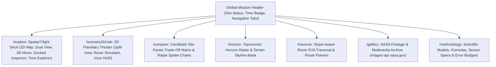

# LunaMission — Design & Interaction Specification

**Status:** Approved production design specification  
**Version:** 2.0  
**Last updated:** 27 October 2026  
**Owner:** LunaMission Principal Product Designer & Systems Architect  
**Related documents:** `docs/../ux-prompt.md`, `docs/../prompt.md`, `docs/PROJECT_BRIEF.md`, `docs/LunaMission_ARCHITECTURE.md`

---

## 1. Product design philosophy & release gates

LunaMission's user experience is designed under the Principal Product Designer guidelines codified in [`ux-prompt.md`](file:///home/tanzim/project/Project/hakathon/test_app/ux-prompt.md) and [`prompt.md`](file:///home/tanzim/project/Project/hakathon/test_app/prompt.md). Every screen enforces non-negotiable release gates:
1. **Immediate Task Clarity:** Users can identify the primary mission planning task within 5 seconds of load.
2. **Discoverable Critical Actions:** Primary mission actions (`Select Site`, `Scrub Epoch`, `Drive Rover`, `Compare Sites`, `Export Dossier`) are visually prominent and unobstructed.
3. **Deterministic Navigation:** Canonical URLs and synchronized state prevent uncertainty about location or active parameters.
4. **Forgiving Interactions:** Non-destructive exploration; modals and fullscreen states yield gracefully to the `Escape` key.
5. **Universal Accessibility:** Fully compliant with **WCAG 2.1 AA** (semantic HTML, complete keyboard navigability, high color contrast, visible focus rings, ARIA landmarks).
6. **Zero Compounding UX Debt:** Components strictly obey Fortune 100 hard ceilings ($\le 200$ lines per UI component).

---

## 2. Multi-page mission control architecture

The application is structured into an authoritative 7-page suite managed by [`useMissionRouter.tsx`](file:///home/tanzim/project/Project/hakathon/test_app/src/app/hooks/useMissionRouter.tsx):

### 2.1 Global scenario state synchronization
All 7 views share a single source of truth managed in [`scenarioContext.ts`](file:///home/tanzim/project/Project/hakathon/test_app/src/app/scenario/context/scenarioContext.ts):
- `selectedSite`: Active Artemis III candidate landing site.
- `customTarget`: Interactive pinpointed landing coordinates $(\phi, \lambda)$ and elevation.
- `epochMs` / `epochIsoUtc`: Active UTC simulation timestamp.
- Switching between tabs guarantees zero state loss: a site or custom target selected on `/explore` remains active on `/compare`, `/horizon`, `/traverse`, and `/scenario/3d-lab`.

---

## 3. Spatial flight deck specifications (`/explore`)

### 3.1 Layout & responsive grid
- **Single View Mode (`map2d` or `globe3d`):** 7/5 responsive column grid pairing the primary spatial canvas (7 columns) with the Point Passport summary (5 columns).
- **Dual View Mode (`dual`):** Full-width 12-column expansion (`col-span-12`), providing $\approx 780\text{px}$ width per viewport (2D Polar Map on the left, 3D Lunar Globe on the right). Point Passport docks into a slide-over drawer triggered by a persistent pill button.
- **Docked Time Explorer:** Mounted directly beneath the spatial viewports, eliminating scroll disconnects and positioning playback controls ($\blacktriangleright, \mathbf{II}, \blacktriangleleft, \blacktriangleright$) in direct proximity to lunar lighting changes.

### 3.2 Non-occluding docked coordinate inspector
- Replaces legacy floating cards with a docked bottom inspector ([`DockedMapInspector.tsx`](file:///home/tanzim/project/Project/hakathon/test_app/src/features/spatial/map/components/inspector/DockedMapInspector.tsx)).
- Displays coordinate geometry, local slope gradient, Beckmann surface roughness, illumination status, and volatile prospecting yield.
- The central South Pole map disc ($80^\circ\text{S} - 90^\circ\text{S}$) remains 100% visible and unoccluded at all times.

### 3.3 Stable 5-slot spatial toolbar
- [`SpatialToolbar.tsx`](file:///home/tanzim/project/Project/hakathon/test_app/src/features/spatial/components/toolbar/SpatialToolbar.tsx) organizes controls into 5 invariant visual slots:
  - **Slot 1 (View Mode):** Segmented buttons for `2D Map`, `Dual View`, and `3D Moon`.
  - **Slot 2 (Camera Presets):** Compact dropdown menu ($\approx 125\text{px}$) supporting all 8 presets (disabled gracefully in 2D mode).
  - **Slot 3 (Layer Switcher):** Multi-spectral layer toggles (LOLA DEM, LROC, Slope, Illumination, Volatiles).
  - **Slot 4 (Custom Pinpoint):** Interactive 3D pinpoint raycasting toggle.
  - **Slot 5 (Actions & Fullscreen):** Flyover tour, Site Compare modal, Mission Dossier export, and Fullscreen toggle.
- Button groups maintain consistent coordinates with zero wrapping or layout shifting across $1280\text{px}$ to $1920\text{px}$ viewports.

---

## 4. Dedicated 3D planetary theater specifications (`/scenario/3d-lab`)

[`Scenario3DLab.tsx`](file:///home/tanzim/project/Project/hakathon/test_app/src/features/spatial/lab/Scenario3DLab.tsx) delivers an unconstrained full-screen planetary theater:
- **Side-by-Side Split View:** Toggles between full-width globe and $50/50$ split view alongside the comprehensive site inspection panel.
- **Surface Rover EVA Simulator:**
  - Activated via `Drive Rover` button or `horizon` preset.
  - Controls: `W` (Accelerate), `S` (Reverse), `A` (Steer Left), `D` (Steer Right).
  - Displays real-time pitch, roll, slope inclination, speed, and heading telemetry.
  - Mast Camera Perspective: Simulates a 25m camera mast for crater rim inspection.
- **Astronaut xEMU Helmet Visor HUD:**
  - Activated via `eva` camera preset.
  - Displays sub-solar heading compass, Earth DTE sightline vector, topocentric elevation, suit consumable telemetry, and simulated oxygen margin.
- **8 Authoritative Camera Presets:**
  1. `nadir`: South Pole Overhead ($90^\circ\text{S}$ downward perspective).
  2. `site`: Oblique $45^\circ$ focus on the selected landing site.
  3. `horizon`: Ground-level crater rim skyline perspective.
  4. `eva`: First-person astronaut helmet perspective.
  5. `earth_align`: Camera boresight aligned directly with Earth's line of sight.
  6. `orbit360`: Continuous circular flyover orbit around the landing zone.
  7. `north_look`: Perspective looking north across the lunar limb toward Earth.
  8. `sunward_terminator`: Camera oriented directly toward the grazing solar illumination vector.

---

## 5. Touch interaction & gesture specifications

Multi-touch gestures ([`useMapGestures.ts`](file:///home/tanzim/project/Project/hakathon/test_app/src/features/spatial/map/hooks/useMapGestures.ts)) provide native mobile and tablet navigation:
- **1-Finger Drag / Pan:** Translates the 2D map or rotates the 3D globe with momentum dampening.
- **2-Finger Centered Pinch-to-Zoom:** Scales the viewport centered on the geometric focal midpoint between touches. Zoom level is clamped strictly within `ZOOM_MIN` ($1.0\times$) and `ZOOM_MAX` ($8.0\times$).
- **2-Finger Rotate:** Calculates angular delta between touch vectors to orient map azimuth.
- **Gesture Arbitration (`touch-action: none`):** Explicitly applied to SVG map containers and WebGL canvas elements, preventing document scroll capture and viewport bounce.

---

## 6. Psychological laws & cognitive ergonomics

| UX Psychology Law | Design Implementation in LunaMission |
| :--- | :--- |
| **Hick's Law** | Reduced choices through progressive disclosure; secondary tools organized in compact dropdown menus. |
| **Fitts's Law** | All interactive touch/click targets $\ge 44\times 44\text{px}$; frequent controls placed near the visual center. |
| **Jakob's Law** | Standard aerospace mission control patterns; universal timeline playback icons ($\blacktriangleright, \mathbf{II}, \blacktriangleleft, \blacktriangleright$). |
| **Miller's Law** | Telemetry and site parameters chunked into 5–9 distinct visual units per inspector panel. |
| **Doherty Threshold** | Sub-400ms perceived response times; optimistic UI updates; asynchronous calculation offloading. |
| **Von Restorff Effect** | Visually distinctive styling for primary mission triggers (`Drive Rover`, `Export Dossier`). |
| **Zeigarnik Effect** | Active custom targets and simulation epochs persist across all page switches. |
| **Peak-End Rule** | Comprehensive, beautifully formatted summary moments in the Executive Mission Dossier export. |
