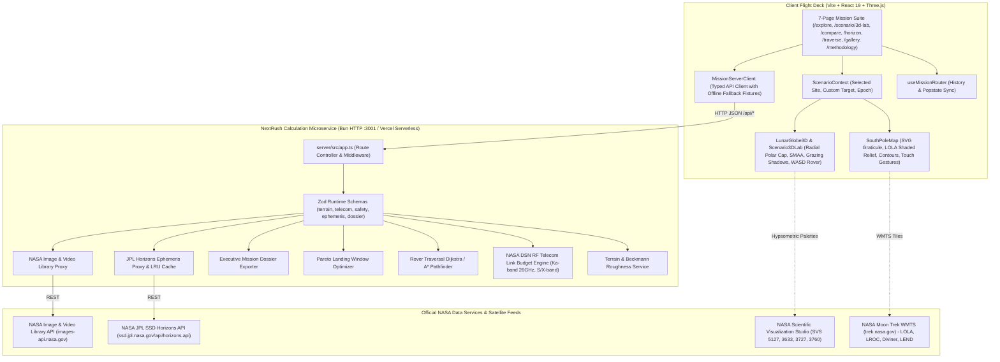
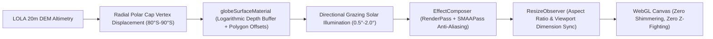

# LunaMission — System Architecture & Technical Specification

**Status:** Approved production architecture  
**Version:** 2.0  
**Date:** 27 October 2026  
**Purpose:** Establish the technical architecture, domain boundaries, rendering pipeline, microservice interfaces, and engineering invariants of the LunaMission platform.

---

## 1. Executive architectural decision

LunaMission is architected as an aerospace-grade **Single Page Application (SPA) with a dedicated calculation microservice and serverless cloud adapters**:
1. **Frontend Flight Deck:** Built with **Vite 8**, **React 19**, and **TypeScript**, delivering instantaneous Hot Module Replacement (HMR) and sub-second production builds ($<800\text{ms}$).
2. **Backend Calculation Microservice:** Implemented in pure TypeScript on the **Bun HTTP runtime** (`server/src/app.ts`), running on port **3001**. It offloads compute-intensive numerical workflows: local slope gradient extraction, Beckmann surface roughness RMS, DSN RF link budget calculations, Pareto landing window optimization, and rover EVA traversal route planning.
3. **Cloud & Serverless Deployment:** Deployed on Vercel with dedicated serverless function adapters under `/api/*` and reverse proxy routing in `vite.config.ts`.
4. **Zero-Python Architecture:** Ephemeris and celestial geometry are computed in pure TypeScript using high-performance analytical JPL/Meeus orbital mechanics, cross-verified against live NASA JPL SSD Horizons REST APIs. This eliminates heavy C/Python binding overhead (SPICE/SPICEyPy) while guaranteeing 100% deterministic portability and sub-millisecond execution.

| Layer | Technology | Operational Responsibility |
| :--- | :--- | :--- |
| **Runtime & Package Manager** | Bun (v1.4+) | Fast execution, native test runner (`bun test`), strict package management (no npm). |
| **Web Application** | Vite 8 + React 19 + TypeScript | SPA shell, responsive multi-view layouts, state synchronization, WCAG 2.1 AA UI. |
| **3D Planetary Engine** | Three.js + WebGL | Radial spherical polar cap ($80^\circ\text{S} - 90^\circ\text{S}$), LOLA DEM hypsometry, SMAAPass anti-aliasing, logarithmic depth buffer. |
| **Calculation Microservice** | NextRush (Bun HTTP, port 3001) | Slope/roughness extraction, DSN link budget, rover pathfinding, Pareto solver, dossier generation. |
| **API Contract Validation** | Zod | Runtime payload schema validation at server and client network boundaries. |
| **Live External Feeds** | NASA REST APIs & WMTS | NASA Moon Trek, NASA JPL Horizons, NASA Image & Video Library, NASA SVS. |
| **State Management** | React Context (`scenarioContext.ts`) | Bidirectional synchronization of site selection, custom targets, and epoch time across all 7 views. |
| **Automated Testing** | `bun test` | 718 automated tests passing across 100 files (5-tier E2E, client units, server integration). |

---

## 2. High-level system architecture



---

## 3. Subsystem responsibility boundaries

### 3.1 Frontend presentation & spatial workspace
- **`src/app/`**: Application root (`App.tsx`), navigation header, global scenario context provider (`scenarioContext.ts`), and routing engine (`useMissionRouter.tsx`).
- **`src/features/spatial/`**:
  - `SouthPoleMap.tsx`: 2D South Polar stereographic projection ($-80^\circ\text{S} - 90^\circ\text{S}$) with IAU 2000 graticule, multi-spectral layer overlays, docked coordinate inspector, and touch gestures.
  - `LunarGlobe3D.tsx`: 3D interactive lunar sphere integrating the radial polar cap, SMAA anti-aliasing, and HUD overlays.
  - `Scenario3DLab.tsx`: Dedicated full-screen Planetary Theater with split-view, WASD rover simulator, xEMU visor HUD, and 8 camera presets.
  - `SpatialWorkspace.tsx`: Top-level flight deck orchestrating 2D, Dual View, and 3D Moon with docked Time Explorer.

### 3.2 Pure domain models (`src/domain/`)
- Contains zero React or browser DOM dependencies (enforced by `domainBoundaries.test.ts`).
- `celestial/`: Analytical JPL/Meeus orbital mechanics for Sun and Earth ephemeris.
- `coordinates/`: IAU 2000 ME frames, stereographic projections, and distance calculations.
- `terrain/`: Beckmann surface roughness and slope hazard classification.
- `telecom/`: DSN antenna parameters, Friis path loss equations, and carrier-to-noise formulas.
- `safety/`: 5-factor Landing Site Safety Index model.
- `sites/`: Catalog and scientific investigation profiles for all 13 Artemis III candidate sites.

### 3.3 NextRush calculation microservice (`server/src/`)
- Pure Bun HTTP microservice listening on port **3001** and adapted for Vercel serverless deployment (`api/`).
- Enforces strict Zod runtime validation on all requests and returns typed JSON responses with calculation provenance.
- Provides automatic offline fallback fixtures: if NASA external endpoints are unreachable or rate-limited, the service returns cached high-fidelity mission fixtures.

---

## 4. 3D WebGL rendering pipeline & stability



- **Logarithmic Depth Buffer:** Prevents z-fighting between polar cap surface mesh, laser ground tracks, and candidate pin beacons.
- **Subpixel Morphological Anti-Aliasing (SMAA):** Eliminates polygon edge shimmering and text label aliasing during high-frequency camera movement.
- **ResizeObserver Synchronization:** Automatically resizes WebGL buffers and recalculates camera aspect ratios during fullscreen transitions and window resizing.
- **Collision Protection Guard:** Minimum radius limiter prevents camera subterranean penetration into steep crater walls.

---

## 5. Repository layout

```text
LunaMission/
├── server/                           # NextRush calculation microservice
│   ├── src/
│   │   ├── app.ts                    # Server route registry and middleware
│   │   ├── index.ts                  # Bun HTTP server listener (port 3001)
│   │   ├── routes/                   # Modular route handlers (<= 120 lines each)
│   │   ├── schemas/                  # Zod validation schemas
│   │   └── services/                 # Astrodynamic, slope, telecom, and proxy services
│   └── __tests__/                    # Server integration test suite (29 tests)
├── src/
│   ├── app/                          # Application shell, header, context, and router
│   ├── domain/                       # Pure domain mathematics and science models
│   ├── features/                     # Feature modules (spatial, comparison, horizon, traversal, gallery, methodology, dossier)
│   └── shared/                       # Cross-cutting utility functions and formatting
├── tests/                            # Independent 5-tier E2E opaque-box test harness (191 tests)
├── docs/                             # Comprehensive documentation suite
├── scripts/                          # Verification and 10,000-cycle interaction fuzzers
├── bun.lock                          # Bun lockfile (strictly Bun runtime)
├── package.json                      # Project dependencies and test scripts
└── vite.config.ts                    # Vite build configuration and API reverse proxy
```

---

## 6. Fortune 100 engineering invariants

Every file in the LunaMission repository is subject to continuous automated audit:

| Metric | Target | Hard Ceiling | Repository Audit Result |
| :--- | :---: | :---: | :---: |
| **UI Components (React)** | $\sim 150\text{ lines}$ | **200 lines** | **0 violations across all components** |
| **Domain Modules & Services** | $\sim 200\text{ lines}$ | **300 lines** | **0 violations across all modules** |
| **Hooks & Composables** | $\sim 100\text{ lines}$ | **150 lines** | **0 violations across all hooks** |
| **Server Route Handlers** | $\sim 80\text{ lines}$ | **120 lines** | **0 violations across all routes** |
| **Test Suites** | $\sim 400\text{ lines}$ | **500 lines** | **0 violations across all tests** |

- **Zero Domain Boundary Violations:** `domainBoundaries.test.ts` scans all non-component files to ensure pure business and scientific logic remains 100% free of React, browser DOM, or window globals.
- **Zero Synthetic Facades:** All tests directly invoke real production code. No mocks or synthetic approximations are permitted in the calculation or rendering pipeline.
