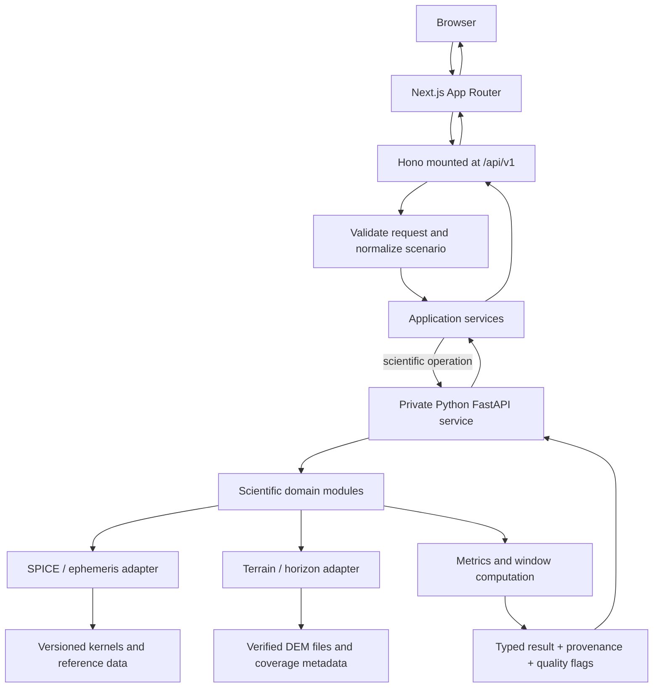

# LunaMission — Architecture & Repository Structure

**Status:** Proposed baseline — team review required  
**Version:** 0.2  
**Date:** 2026-10-19  
**Purpose:** Establish the initial stack, system boundaries, repository layout, API direction, and implementation order. This is a proposal, not a claim that every scientific input has been validated.

## 1. Executive decision

Build LunaMission as a **Next.js application with Hono as the primary HTTP API**, plus a **separate Python scientific service only for calculations that need its ecosystem**. The browser talks to one public API. Hono owns the external API contract and delegates scientific requests to Python behind the server boundary when that service is enabled.

| Layer | Recommendation | Rationale |
|---|---|---|
| Web application | Next.js App Router + TypeScript | UI, routing, Server Components, and same-origin backend-for-frontend in one app |
| Primary HTTP API | Hono mounted inside Next.js Route Handlers | Typed route composition and middleware while keeping one public API surface |
| 3D | Three.js; consider React Three Fiber if it speeds up the team | Globe rendering, surface picking, Sun/Earth visualization |
| Scientific service | Python + FastAPI, introduced when the science spike requires it | Separate runtime for SPICE/terrain/numerical dependencies; can be run as a normal service/container |
| Ephemeris | SPICE via SPICEyPy if validated by the feasibility spike | Mature planetary/spacecraft geometry ecosystem; exact kernels and frames still require validation |
| Numerical / terrain work | NumPy first; add raster libraries only for a selected, verified DEM | Keep dependency and data-download cost limited |
| TypeScript API contracts | Zod (or equivalent) at the Hono request boundary; derive route types from schemas | Runtime validation and TypeScript safety |
| Python service contract | Pydantic + FastAPI OpenAPI; generate or validate the TypeScript client from OpenAPI | Avoid hand-maintaining mismatched cross-language DTOs |
| Tests | pytest, Vitest, Playwright | Science/service unit tests, UI units, end-to-end user journey |
| Local development | `pnpm` for the web app; `uv` for Python if/when it is added | Separate ecosystem tooling without forcing an unnecessary monorepo framework |
| Deployment | Next.js web/API plus a private Python service only if enabled | Keeps ordinary app requests simple and scientific dependencies isolated |

Do not add Redis, a database, a queue, microservices, an AI service, trajectory solver, or full RF link-budget service unless the MVP proves it needs one. The Python service is a deployment boundary for scientific work—not a second public API for the browser.

## 2. Product boundary

### MVP

1. Select a supported lunar south-pole location.
2. Select a UTC timestamp or time interval.
3. Display Sun geometry and a correctly qualified illumination result.
4. Display Earth direction, geometric visibility, range, and theoretical one-way light-time.
5. Compare at least two locations using the same epoch and assumptions.
6. Show units, method, data coverage, model/kernel versions, and quality flags.
7. Add a timeline/window summary if point-in-time calculations are validated early enough.

### Explicitly deferred

- Spacecraft trajectory, launch windows, delta-v, and propellant estimates.
- Operational RF link guarantees or full RF link budget.
- Survival probability or safety percentage without a validated probabilistic model.
- Terrain-aware claims outside verified DEM coverage.
- AI-generated scientific values.
- Microservices, distributed jobs, accounts, and a database unless a real requirement emerges.

A global 3D Moon may aid exploration, but scientific claims should be limited to locations and data coverage the team can validate.

## 3. High-level architecture



### Responsibility boundaries

**Next.js app** owns pages, layouts, server/client component boundaries, rendering, and server-side UI data loading. Server Components should fetch directly from the underlying source/service where suitable rather than making an unnecessary HTTP round-trip through the app's own Route Handler.

**Hono public API** is mounted through the Next.js App Router, for example at `app/api/[[...route]]/route.ts`. It owns browser-facing routes, request validation, consistent errors, and application orchestration. Keep this API as the single public surface; the browser does not call the Python service directly.

**Application service layer** coordinates requests and maps the stable public API contract to an internal Python contract. It should not duplicate astronomy/geometry math.

**Python scientific service (conditional)** owns calculations that benefit from SPICEyPy, NumPy, and terrain/raster tooling. Keep its scientific domain separate from FastAPI route handlers. Run it as a normal long-lived process/container if needed; do not assume large kernels, DEM files, or long calculations fit comfortably inside a short-lived serverless request.

**Data adapters** load known SPICE kernels and DEMs, record versions/checksums/coverage, and fail clearly when required data are missing or unsupported.

**Suitability assessment** evaluates named mission constraints and explains pass/fail/unknown outcomes. It must not label a heuristic score as a survival probability.

## 4. Repository layout

```text
LunaMission/
├── README.md
├── CONTRIBUTING.md
├── .gitignore
├── .editorconfig
├── .env.example
├── package.json                 # pnpm scripts; avoid extra orchestration tooling initially
├── pnpm-workspace.yaml          # only if multiple JS packages/workspaces are actually needed
├── docs/
│   ├── PROJECT_BRIEF.md
│   ├── PRD.md
│   ├── DECISIONS.md
│   ├── ARCHITECTURE.md
│   ├── SCIENCE_FEASIBILITY.md
│   ├── API_CONTRACTS.md
│   ├── DESIGN_SPEC.md
│   └── VALIDATION_PLAN.md
├── apps/
│   ├── web/                     # Next.js App Router + Hono public API
│   │   ├── package.json
│   │   ├── next.config.ts
│   │   └── src/
│   │       ├── app/
│   │       │   ├── (product)/
│   │       │   └── api/[[...route]]/route.ts
│   │       ├── server/
│   │       │   ├── api/         # Hono app, middleware, routes
│   │       │   ├── services/    # application orchestration
│   │       │   └── clients/     # typed Python-service client, if enabled
│   │       ├── features/
│   │       │   ├── lunar-globe/
│   │       │   ├── site-selection/
│   │       │   ├── point-passport/
│   │       │   ├── comparison/
│   │       │   └── timeline/
│   │       ├── components/
│   │       ├── lib/
│   │       └── test/
│   └── science/                 # optional until the feasibility spike warrants it
│       ├── pyproject.toml       # uv-managed Python environment
│       ├── app/
│       │   ├── main.py          # FastAPI internal service
│       │   ├── api/
│       │   ├── schemas/          # Pydantic internal contract
│       │   ├── domain/
│       │   │   ├── geometry/
│       │   │   ├── illumination/
│       │   │   ├── visibility/
│       │   │   ├── range_light_time/
│       │   │   ├── windows/
│       │   │   └── suitability/
│       │   ├── adapters/
│       │   │   ├── spice/
│       │   │   └── terrain/
│       │   └── infrastructure/
│       └── tests/
│           ├── unit/
│           ├── integration/
│           └── fixtures/
├── data/
│   ├── README.md
│   ├── manifests/
│   ├── kernels/                 # downloaded; normally git-ignored
│   └── dem/                     # large DEM files; normally git-ignored
├── scripts/
│   ├── check-data.py
│   └── generate-science-client.sh
└── .github/workflows/ci.yml
```

### Repository rules

- Keep large kernels and DEMs out of Git unless repository size and licensing make that intentional.
- Commit manifests, source URLs, acquisition instructions, versions, checksums, and coverage metadata.
- Keep `apps/science/app/domain/` independent of FastAPI so science tests can run directly.
- Keep both Hono and FastAPI route handlers thin: validate request → call a service/domain function → return a typed response.
- Do not create a package for every module; extract packages only when a real reuse or dependency-boundary need appears.
- If Python is not yet justified, start with `apps/web`, `docs`, `data/README.md`, and tests; add `apps/science` only when the feasibility spike confirms its role.

## 5. Initial API direction

The **browser-facing contract** lives under `/api/v1` and is implemented by Hono inside Next.js. These routes are proposals; finalize request/response schemas after the science spike.

| Public endpoint (Hono) | Purpose |
|---|---|
| `GET /api/v1/health` | App/API health; optionally reports whether the science service is ready |
| `GET /api/v1/coverage` | Supported locations/time range and available terrain products |
| `POST /api/v1/point/conditions` | Compute point-in-time Sun/Earth metrics through the appropriate service |
| `POST /api/v1/compare` | Compute multiple locations with shared time/settings |
| `POST /api/v1/point/timeline` | Sample metrics across an interval and derive candidate windows |

If/when Python is introduced, expose only a **private internal interface** to Hono, such as `POST /internal/v1/point/conditions` and `POST /internal/v1/point/timeline`. Keep it off the public ingress if the deployment supports private networking; otherwise apply service authentication, strict timeouts, payload limits, and network restrictions. The frontend must not call these internal endpoints directly.

Do not expose trajectory/fuel endpoints in the MVP until a validated solver and explicit vehicle model exist.

Every public scientific request/response—and the internal Hono↔Python contract—must define:

- Coordinate convention: planetocentric or planetographic latitude; longitude direction/range.
- UTC timestamp and supported time range.
- Reference frame and target/observer definitions where relevant.
- Units for every physical quantity.
- Calculation method and model/data identifiers.
- Data-quality state such as `available`, `estimated`, `unsupported`, or `insufficient_data`.
- Error cases for invalid input, missing kernels/data, unsupported coverage, and computation failure.

Missing data must not be encoded as `0`, `false`, or an empty string unless that value genuinely means zero/false/empty.

## 6. Scientific truth constraints

1. **One canonical UTC epoch.** Convert display-local time at the UI boundary; all panels in a comparison use the same underlying epoch.
2. **Explicit coordinate conventions.** Document latitude type, longitude direction, body-fixed/inertial frames, and reference ellipsoid as applicable.
3. **Geometry is not terrain.** A body or Sun direction above an ideal horizon does not prove local terrain is unobstructed.
4. **Visibility is not communications success.** Geometric direct-to-Earth visibility is not an RF link budget or guarantee of contact.
5. **Light-time is not network latency.** Label theoretical one-way and round-trip vacuum light-time separately from actual system latency.
6. **A global texture is not a DEM.** Terrain-aware calculations require suitable elevation data and a validated coverage pipeline.
7. **No unsupported certainty.** Missing data yields `insufficient_data` or `unsupported`, not a favorable status.
8. **Reproducibility.** Preserve scenario inputs and data/model versions needed to reproduce results.
9. **Independent validation.** Compare outputs against a trusted reference or independently computed case; record tolerances and known differences.
10. **Timeline boundaries matter.** Disclose sample step and event-detection method; refine around detected transitions when feasible.

## 7. Caching and performance

Start simple:

- Cache loaded SPICE kernels and parsed/static DEM metadata inside the Python science process, if present.
- Cache expensive results only with keys that include coordinates, UTC epoch, frames, kernel/data versions, algorithm version, and relevant options.
- Cancel or ignore stale frontend requests when the user scrubs time quickly.
- Bound timeline range and sampling interval.
- Add a persistent cache only if measurements show a need.
- Version changes must invalidate cached results; reproducibility takes precedence over cache hits.

## 8. Data management and configuration

Use environment variables for deployment-specific settings such as `LUNAMISSION_ENV`, `LUNAMISSION_DATA_DIR`, `LUNAMISSION_KERNEL_MANIFEST`, `LUNAMISSION_ALLOWED_ORIGINS`, `LUNAMISSION_LOG_LEVEL`, and (only if Python is enabled) `LUNAMISSION_SCIENCE_SERVICE_URL`. Keep the Python service URL server-only; never expose it as a `NEXT_PUBLIC_*` variable. Keep secrets out of source control. The basic local demo should not need secrets if its data files are already present.

Each external data product should have a manifest entry with name/source URL, provider, citation, product/version, license/usage check, download date, checksum, spatial/temporal coverage, resolution/units, limitations, and validation status.

## 9. Testing strategy

### Backend/science

- Coordinate conversion, longitude wrap, poles, and known landmark mapping.
- UTC parsing and supported time boundaries.
- Frame/target consistency and kernel availability.
- Sun elevation and illumination sanity cases.
- Earth range/light-time units; one-way light-time must equal range divided by the speed of light under the documented range definition.
- Earth-center horizon cases and terrain obstruction where DEM coverage is verified.
- Timeline window boundaries and sampling-step sensitivity.
- Missing-kernel, missing-DEM, and out-of-coverage behavior.
- Deterministic reruns for fixed inputs and fixed data/model versions.

### Frontend

- Selecting a location updates coordinates and profile.
- Changing UTC time updates all time-dependent panels together.
- Comparisons use the same epoch.
- Loading, empty, unsupported, and error states are understandable.
- Old network responses cannot overwrite newer selections.

### End-to-end acceptance path

1. Open the app.
2. Select a supported south-pole location.
3. Select a UTC timestamp.
4. Inspect Sun/Earth results with units and quality labels.
5. Add a second location and compare at the same epoch.
6. Change the epoch and confirm all metrics update together.
7. Reproduce the scenario from saved inputs and data/model identifiers.

## 10. Implementation sequence

### Milestone 0 — Repository and setup
- Create the Next.js App Router app and Hono catch-all route; add linting, formatting, type checks, CI, and a health endpoint. Add a basic page and placeholder Moon view. Do not require Python to boot the web app.
- **Done when:** a fresh checkout can start the web app using documented commands, and the Hono `/api/v1/health` route passes tests.

### Milestone 1 — Science feasibility spike (before major UI investment)
- Select one reference location and UTC epoch. Prove the calculation in the smallest environment that fits the selected library—likely a Python spike using SPICEyPy if those dependencies are needed. Load required kernels; compute Sun/Earth directions in a documented frame and Earth range/light-time; compare with a trusted/independent reference or documented sanity case. Decide whether the code should become the separate Python service or whether a smaller implementation is sufficient. Record assumptions, tolerances, and unsupported cases in `SCIENCE_FEASIBILITY.md`.
- **Done when:** one repeatable result passes a written validation check and the team records whether Python is required for the MVP.

### Milestone 2 — Vertical slice
- Connect one UI location selection to the Hono API; Hono calls the private Python service only if the validated science implementation lives there.
- Render a point profile with units, timestamp, method, and quality state.
- Add loading, failure, and unsupported-data states.
- **Done when:** the same input reliably reproduces the same validated output.

### Milestone 3 — Comparison and timeline
- Add multiple supported sites at a shared UTC epoch.
- Add interval sampling/window summaries after point calculations are trusted.
- Test transitions and sampling limitations.

### Milestone 4 — Verified terrain and polish
- Add terrain-aware calculations only for verified coverage.
- Improve 3D, explanations, accessibility, export, and demo narrative.
- Freeze scope before final integration.

## 11. Key risks

| Risk | Mitigation |
|---|---|
| SPICE frames/kernels misunderstood | Build a small reference case; document frames, targets, observers, kernels, and time coverage |
| DEM coverage/resolution insufficient | Publish coverage metadata; mark unsupported regions; retain clearly labeled geometry-only mode |
| Team spends too long on 3D | Build a working metric vertical slice first; treat 3D as a presentation layer |
| Public API/internal science contract drift | Validate Hono inputs and generate/validate its Python client from FastAPI OpenAPI; test representative responses |
| Timeline misses short windows | Show sampling method and limitations; refine around transitions |
| Demo relies on large download/live service | Pin required data, preflight it, cache locally, and test limited-network behavior |
| Scope expands into AI/trajectory/survival scores | Keep explicitly deferred until the core challenge workflow is complete and validated |

## 12. Open decisions for team review

1. Which exact candidate sites will the demo support?
2. Which SPICE kernels, frames, and time range will be tested?
3. Which terrain product covers each chosen site at adequate resolution?
4. What independent reference case validates geometry/illumination?
5. Is 3D-first justified, or should the team begin with a simpler local-horizon view?
6. Is a timeline in MVP after point-in-time calculations pass validation?
7. What pre-event work and external data use are permitted by current event rules?

Record each decision with date, owner, rationale, consequences, and status in `DECISIONS.md`.

## 13. Architecture readiness checklist

- [ ] Team agrees on MVP boundary and proposed stack.
- [ ] First SPICE/geometry feasibility experiment has a reproducible result.
- [ ] Coordinate, time, frame, units, and quality conventions are documented.
- [ ] Public Hono contracts and the internal Hono↔Python contract (if needed) are reviewed by the relevant owners.
- [ ] Data acquisition, licensing, coverage, and local demo setup are understood.
- [ ] A vertical-slice owner and independent science reviewer are named.

**Next artifact:** `SCIENCE_FEASIBILITY.md`  
**Immediate task:** validate one point-and-time scientific calculation before expanding the application.


## 14. Technical references

- Hono official Next.js integration: https://hono.dev/docs/getting-started/nextjs — demonstrates Hono in the App Router via `app/api/[[...route]]/route.ts` and `@hono/vercel`; its Next.js integration states the Node.js runtime is supported.
- Next.js Backend for Frontend guide: https://nextjs.org/docs/app/guides/backend-for-frontend — describes Route Handlers as public API endpoints and notes that Next.js backend capabilities are a backend-for-frontend layer, not a full backend replacement.
- Next.js Route Handlers: https://nextjs.org/docs/app/getting-started/route-handlers — documents `route.ts` conventions and supported HTTP methods.
- SpiceyPy documentation: https://spiceypy.readthedocs.io/en/main/ — documents the Python wrapper for the SPICE Toolkit.

These references establish integration options, not scientific correctness. Kernel choice, coordinate frames, data coverage, and all reported metrics still require independent validation.
