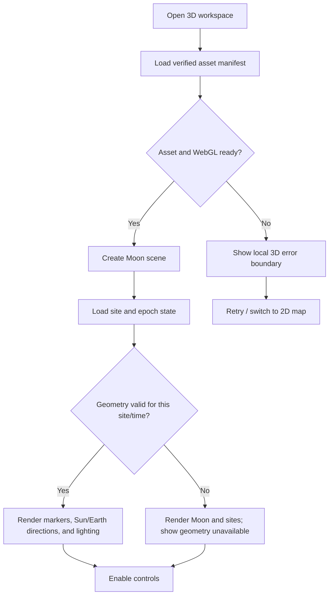
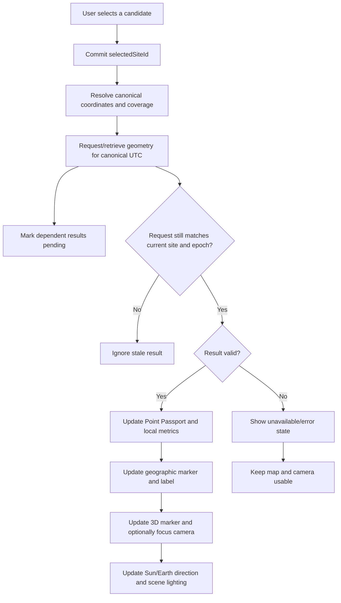
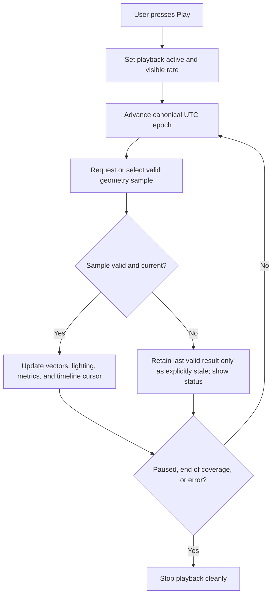
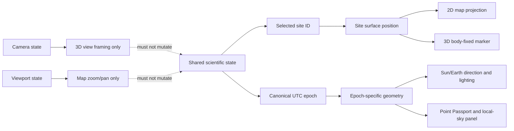

# LunaMission — 3D Lunar Experience Specification

**Document purpose:** implementation-grade UX, scientific-visualization, interaction, state, architecture, and QA specification for the LunaMission 3D Moon workspace.  
**Audience:** Google AI Studio / Gemini, Claude Code, Codex, frontend engineers, scientific-computing engineers, UX, and QA.  
**Status:** Proposed implementation baseline. Must be reconciled with the actual repository, validated datasets, API contracts, and current scientific feasibility results before scientific claims are enabled.

---

## 1. Executive direction

Build a **premium scientific 3D observatory with playful, direct manipulation**: the Moon should feel explorable and responsive, but never like a game asset with made-up science. It should feel tactile through camera inertia, deliberate focus transitions, clear hover/selection feedback, time scrubbing, light/shadow changes, and visible Sun/Earth directions—not through exaggerated terrain, random orbital motion, or decorative effects.

The 3D view serves five purposes:

1. **Orient:** understand the selected lunar region in global lunar context.
2. **Inspect:** rotate, zoom, and focus on a supported candidate site.
3. **Select:** choose candidates through genuine geographic hit-testing and synchronize the selection with the 2D map and Point Passport.
4. **Understand geometry over time:** observe calculated Sun illumination direction and Earth's apparent direction as the canonical UTC epoch changes.
5. **Explain uncertainty:** show whether terrain, lighting, line-of-sight, and model coverage are actually supported.

The 3D globe is not the scientific source of truth. Scientific services and validated data supply the state; the renderer visualizes it. The 2D south-pole map remains the precision-oriented workspace.

### Non-negotiable rules

- Never invent Sun/Earth position or movement for visual effect.
- Never infer scientifically meaningful elevation or terrain visibility from an artistic texture.
- Never let camera movement mutate the selected site, epoch, or scientific result.
- Never claim exact scale when an object has been visually exaggerated for legibility.
- Never allow a 3D renderer failure to break the 2D map, time controls, or metrics.
- Never label mocked or illustrative values as live, verified, terrain-aware, or benchmarked.

---

## 2. What the current screenshots tell us

The present 3D mode has two opposite composition failures:

- In one view, the lunar surface is zoomed so far in that the Moon is cropped by the viewport. The exaggerated relief/high-contrast displacement looks spiky and noisy.
- In another view, the Moon is too small and centered in a huge black canvas, leaving substantial unused space. A small blue wireframe-like globe floats above it and reads as a debug marker rather than a recognizable Earth.
- The Sun appears as a yellow arrow/direction marker rather than an understandable luminous source; lighting and the displayed arrow can appear disconnected.
- Candidate markers overlap in the south-polar area. Large text plaques obscure the surface, and multiple blue dots stack into an indistinct cluster.
- The selected site does not always feel anchored to the surface, and changing candidates can leave awkward camera framing.
- The canvas sometimes appears to have a valid scene but weak composition: no purposeful focal hierarchy, limited explanatory affordances, and controls not clearly tied to camera intent.

These are not solved by adding more glow or detail. They require a documented camera model, a consistent frame conversion path, deliberate visual scale policy, label decluttering, and interaction contracts.

---

## 3. Visual philosophy

### 3.1 Target aesthetic

**Scientific observatory + cinematic spatial exploration.** Maintain LunaMission's dark navy canvas, restrained cyan for selection, blue for Earth, warm gold for the Sun, subtle panel borders, compact technical labels, and evidence-first wording.

The experience can feel game-like through interaction quality, not gamification:

- Smooth inertial rotation with predictable limits.
- Direct site selection and focus transitions.
- Time playback with visible rate and a scrubber.
- Focus presets that animate cleanly.
- Clear hover targets and selection feedback.
- Small, responsive motion that explains state changes.
- No score, arbitrary mission rating, fake progress, particle fireworks, or arcade HUD unless explicitly approved as a separate design decision.

### 3.2 Surface appearance

- Use a verified lunar model or compatible color/height datasets. NASA's CGI Moon Kit offers LRO-derived color and elevation maps; NASA's 2026 Moon web-model page includes smaller and larger GLB options and separate texture-only vs topographic model variants. Choose an asset based on actual format, dimensions, coverage, license/attribution, and measured browser cost, not merely the highest resolution.
- Do not use a high-frequency displacement map with arbitrary amplitude. The current bumpy, noisy surface indicates displacement/normal intensity may be excessive, height scale may be inconsistent with the model radius, texture filtering may be poor, or the terrain mesh may not suit the chosen camera. Inspect the asset and shader settings before changing values.
- Begin with verified color imagery and restrained directional shading. Enable true geometric displacement only when the asset genuinely supplies appropriate height data and the renderer can use it correctly.
- Do not call a color map an elevation map. Do not call normal/bump-map relief a validated terrain profile.
- Use subtle surface roughness; avoid shiny plastic, exaggerated bump, neon glow, and overly saturated blue-gray terrain.
- Use a low-key star background only if it helps depth. It must not compete with the Moon, vectors, or labels.
- Avoid atmospheric halos around the airless Moon unless the effect is explicitly illustrative and labeled.

### 3.3 Lighting

- A directional key light represents the Sun direction supplied by the scientific result.
- A small restrained ambient/fill contribution can preserve surface readability, but must not wash out the terminator.
- If shadows are not calculated from the terrain data or supported by the renderer, do not imply precise terrain-shadow accuracy.
- Lighting changes with the selected epoch only when the computed direction is updated from the same validated result used by the metric panels.
- Camera rotation must not change the physical direction of sunlight in the lunar frame.
- In a fixed-epoch preview, moving the camera shows the same static illumination from a different angle.
- In time playback, the lighting direction evolves only according to supplied ephemeris samples or a validated interpolation policy.

---

## 4. Object and scale policy: Moon, Sun, and Earth

Physical distances make a literal-to-scale scene poor for user interaction: the Moon would become tiny if Earth and Sun were placed at their true distances in the same perspective scene. Therefore, separate **scientific direction** from **screen-space presentation size**.

### 4.1 Moon

- The Moon is the primary 3D body and should occupy a purposeful fraction of the viewport.
- In normal Explorer mode, target a diameter around 55–78% of the shorter usable canvas dimension, adjusted to the camera preset and aspect ratio. This is a starting design target, not a fixed pixel size.
- In fullscreen mode, fit the intended view with safe margins for labels and controls; do not crop the sphere by default.
- In site-focus mode, allow a closer view of the south-polar region, but preserve enough context to understand orientation and avoid accidental extreme magnification.
- Respect the model's coordinate orientation and actual topography. Surface markers must be generated from site coordinates transformed into the same body-fixed/rendering frame as the model.

### 4.2 Sun representation

The Sun should communicate both **light source** and **direction**.

- Use a warm gold compact sun disc or icon, optionally with a restrained bloom. Do not render an enormous Sun sphere near the Moon and imply that the distance is to scale.
- Use a clearly visible directional ray/arrow or direction guide when the Vectors layer is enabled.
- Draw the vector in a documented coordinate frame. Prefer an anchored sky-direction indicator or an overlay for apparent direction when a large in-scene line could imply a physical path.
- Keep the yellow/gold label, symbol, direction line, and metric values consistent.
- Show elevation and azimuth only when computed for the selected observer/site and epoch.
- Make below-horizon states visually distinct and explicit; do not always place the Sun above the horizon for visual appeal.
- The Sun's scene-light direction and visible direction marker must come from the same direction result, transformed consistently to the scene frame.

### 4.3 Earth representation

Earth should look like a recognizable planet, not a floating blue wireframe sphere/debug globe.

- Prefer a real or well-grounded Earth color texture with restrained cloud detail if available and practical. If no verified asset is available, use a clean blue/white directional disc or sphere with no false geographic claims rather than a wireframe mesh.
- The Earth marker is a **direction cue from the selected lunar observer**, not a nearby object hovering over the Moon.
- Keep its apparent angular size accurate if the data and view projection support it. If enlarged for touch targets/readability, label it as a visual enlargement or use a separate overlay marker so the 3D physical distance remains honest.
- Use a sky-direction marker, a dashed sightline, and an unobtrusive label as needed. Keep this presentation visually distinct from a true orbital trajectory.
- Make the marker responsive to the selected epoch and selected site. The apparent direction can change across sites and time only as supported by the ephemeris/geometry.
- If Earth is below the modeled local horizon, show it below the horizon in the local-sky panel; do not silently move it above the horizon. A scene overlay may still identify its direction if clearly labeled.
- Do not depict Earth-centered communications as successful just because the Earth marker is visible.

### 4.4 Visual-scale disclosure

Provide a compact legend/help disclosure such as:

- `Directions from selected site`
- `Sun direction / scene lighting`
- `Earth direction — visual marker may be enlarged`
- `Not to scale` where visible object size/distance is exaggerated.

Do not include a visual scale disclaimer on every element; show it once in the appropriate legend or help panel.

---

## 5. 3D view modes and camera behavior

Implement a purposeful camera state machine. Camera state is presentation state, separate from scientific application state.

### Mode A — Global Context

**Use case:** understand where the south-polar candidates sit on the Moon.

- Show most or all of the Moon with comfortable margin.
- Keep the selected candidate marker visible when it is on the visible hemisphere; if it is on the far side, indicate that honestly and offer Focus Site.
- Show only a limited number of high-priority labels.
- Allow orbit and zoom with sensible bounds.
- Avoid clipping the lunar sphere.
- Provide a `South Pole` / `Focus Region` action.

### Mode B — South-Pole Focus (default for challenge workflow)

**Use case:** inspect a supported south-polar candidate and nearby terrain.

- Orient the camera to give a readable view of the south-polar region and surrounding crater context.
- Center the selected candidate or the supported candidate cluster without moving markers on the surface.
- Keep the surface curvature and terrain relief perceptible but not grotesquely exaggerated.
- Show candidate sites as small points, with one selected highlight.
- Use compact labels and collision handling. Do not put large rectangular labels over every site.
- Keep the Sun/Earth direction indicators available without filling the screen with long arbitrary arrows.

### Mode C — Oblique Terrain

**Use case:** understand relief around crater rims, ridges, and nearby terrain.

- Tilt the camera for a clear local surface perspective.
- Use available actual terrain geometry; if the model has no verified height component, do not imply quantitative local relief.
- Keep selected-site markers attached to their geographic locations.
- Cap zoom and camera elevation to prevent the camera from crossing through the surface or becoming embedded unintentionally.
- Provide a one-action return to South-Pole Focus.

### Mode D — Selected Site Focus

**Use case:** inspect a single selected candidate.

- Smoothly center the selected candidate and choose an appropriate distance based on local terrain/context scale.
- Preserve selected candidate identity and epoch.
- Avoid snapping so close that the site label overlaps every nearby marker.
- Provide an obvious Back to Region / Focus South Pole action.
- Interrupt the animation when a user starts dragging or otherwise manually controls the camera.

### Camera control rules

- Pointer drag rotates/orbits the view; wheel or pinch zooms; an alternate drag/gesture pans only if it does not make selection unreliable.
- Provide accessible explicit controls for zoom, reset, Focus South Pole, Focus Selected Site, Global Context, and Oblique.
- Use damped, bounded movement; no perpetual auto-rotation by default.
- If optional auto-rotate exists, label it and keep it slow. Stop it when the user interacts. Respect reduced motion.
- Camera transitions use short, interruptible easing; do not animate camera and selected-site changes through unrelated paths.
- Do not tie camera orbit to the mission time animation.
- In fullscreen, resize the renderer and camera projection correctly; exit restores the prior layout and useful camera state.

---

## 6. Candidate marker and label UX

The current screenshots show large plaques and overlapping cyan dots near the south pole. Correct this at the scene/data-layer level.

### Marker states

- **Selected:** one high-contrast cyan/turquoise point at the actual site location, with one thin halo/pulse ring. Prefer a subtle single animation on change, not perpetual pulsing.
- **Hovered/focused:** a restrained outline and short label/tooltip. Hovering previews but does not commit selection.
- **Comparison:** distinguishable outline/secondary accent. Must not be confused with the committed selected site.
- **Ordinary candidate:** small muted marker.
- **Unsupported/custom point:** different shape or outlined marker, with a clear type label.
- **Unavailable coordinate:** do not render a bogus point; show the site in the list with an unavailable-coordinate status.

### Geographic correctness

- Candidate markers originate from canonical candidate coordinates transformed into the model's documented body-fixed frame, then rendered at the actual surface location.
- If the model surface is a sphere without topography, place a marker slightly above the sphere's mathematical surface for z-fighting prevention, but describe this as a rendering offset only. Do not use it as a scientific altitude.
- If using real terrain mesh, calculate/lookup the corresponding surface height only when the dataset and coordinate mapping support it.
- Do not position markers using independent screen coordinates.
- Use the same candidate ID and geographic transform across map, globe, hit testing, labels, and custom-point display.

### Label decluttering

- Selected label has top priority; next are hovered/focused labels; then close comparison candidates; then major crater names; then general sites.
- Do not render a large full-width badge over a tight cluster of every site.
- Project candidate anchors into screen space; place labels in available nearby positions; use short leader lines when helpful.
- Hide lower-priority labels when they collide and provide hover/focus popovers or a nearby-sites list to retain access.
- Avoid hiding the selected site label even if other labels must be removed.
- Re-run decluttering on camera changes, resize, zoom, selection, and mode changes with reasonable throttling.
- Do not alter world coordinates to solve screen-space label collisions.

---

## 7. Sun/Earth motion and simulation model

This feature must feel alive while being scientifically honest.

### Separate three kinds of motion

1. **Camera motion:** user rotates/zooms the view. It must not change the canonical epoch or physical positions.
2. **Epoch progression:** Play changes the canonical UTC epoch by a displayed simulation rate; this drives scientific updates.
3. **Rendering transitions:** short easing for camera focus, marker selection, and UI changes. These transitions do not represent celestial motion.

Never conflate these. A spinning Moon caused by pointer drag is not time progression. A glowing marker moving independently of the ephemeris is not the Sun's motion.

### Time controls

- Provide Play/Pause, step backward/forward, a visible rate selector, and a time scrubber or synchronized Time Explorer.
- Show canonical UTC clearly.
- Offer moderate rates such as `1×`, `10×`, `60×`, and explicit `1 hour / second` only if the UI explains how simulation time advances. Do not hide the rate.
- Pause immediately stops epoch progression and freezes the time-driven scene state. Camera manipulation remains available.
- Scrubbing to a timestamp updates the canonical epoch and all time-dependent outputs.
- Switching camera modes does not change time.
- Restart/Reset time returns to a defined starting epoch only after user action; don't unexpectedly reset on candidate change.

### Source of motion

- Use the application's scientific backend/API or validated SPICE/JPL ephemeris results for Sun/Earth state and transformations.
- The selected site and epoch must be included in, or be verifiably associated with, the result identity.
- The renderer consumes validated direction vectors and derived values; it must not invent celestial states in the component.
- If precomputed samples are used, animate only between supported samples under a documented interpolation method. Mark the displayed values as interpolated when that affects interpretation.
- If an epoch lies outside data/kernel coverage, pause or disable simulation at the boundary and show a recoverable coverage message. Do not continue with fabricated orbit positions.
- For smooth visual movement between samples, interpolation may be used only when scientifically appropriate and bounded by valid samples; the metric panel must not imply a new validated calculation if only visual interpolation exists.

### Sun behavior

- The direction marker, local elevation/azimuth, and directional lighting come from the same epoch-consistent geometry result.
- When time moves, the Sun's direction guide and surface illumination update together.
- Below-horizon or terrain-obstructed state is represented honestly.
- Shadows should use actual supported geometry and a clear quality/coverage label; a global texture alone does not support terrain occlusion.

### Earth behavior

- Earth direction and local elevation/azimuth use the same observer/site and epoch result as the Point Passport.
- The direction marker follows the actual result; it is not an orbiting object with arbitrary speed.
- A visible Earth marker does not prove line-of-sight is terrain-clear, and geometric visibility does not prove radio-link success.
- If the selected Earth direction falls below the mean horizon, place/report it consistently with the chosen local-sky representation. Apply terrain occlusion only when verified terrain analysis supports it.

### Rate limits and rendering performance

- Do not issue an unbounded scientific API request on every animation frame.
- Separate high-rate render updates from lower-rate scientific computation.
- Throttle or sample epoch calculation requests according to the service contract; keep the selected canonical epoch explicit.
- On slow response, show updating state, avoid applying stale samples, and allow pause/cancel.
- The visual simulation must degrade gracefully on low-powered devices.

---

## 8. Interaction flow diagrams

### 8.1 Startup and failure recovery



### 8.2 Candidate selection



### 8.3 Time playback



### 8.4 Camera and selection state separation



---

## 9. Screen layout and control hierarchy

### Normal mode

```text
┌─────────────────────────────────────────────────────────────────┐
│ LunaMission · UTC / Play controls · model / geometry status      │
├─────────────────────────────────────────────────────────────────┤
│ 3D Workspace Toolbar                                             │
│ Global | South Pole | Oblique | Focus Site | Reset | Fullscreen  │
├───────────────────────────────────────┬─────────────────────────┤
│                                       │ Selected Site / Point   │
│             3D Lunar Scene            │ Passport                │
│                                       │ Sun & Earth metrics     │
│       Moon + candidate markers        │ Geometry / coverage     │
│       Sun lighting + Earth direction  │ Method / limitations    │
│                                       │                         │
├───────────────────────────────────────┴─────────────────────────┤
│ Time Explorer below the complete spatial workspace              │
└─────────────────────────────────────────────────────────────────┘
```

- The Moon should not be a tiny ball floating in an empty viewport or an over-zoomed surface clipped by default.
- The selected site panel can collapse in immersive mode but must remain one action away.
- Keep essential status and exit controls visible in fullscreen.
- The Time Explorer remains in normal document flow; fullscreen map interaction must not cause it to overlay the viewport.

### Fullscreen mode

```text
┌─────────────────────────────────────────────────────────────────┐
│ 3D mode · camera preset · layer toggles · Exit Fullscreen        │
├─────────────────────────────────────────────────────────────────┤
│                                                                 │
│                  Large, correctly framed Moon                   │
│        Sites · selected marker · Sun/Earth direction             │
│                                                                 │
│  Compact legend                                      Zoom/Reset  │
│                                                                 │
├─────────────────────────────────────────────────────────────────┤
│ Candidate strip / optional compact site context                 │
└─────────────────────────────────────────────────────────────────┘
```

### 3D toolbar

Group controls by purpose:

- **Camera:** Global, South Pole, Oblique, Focus Site, Reset.
- **View:** 2D Map, Dual View, 3D Moon.
- **Layers:** Grid/Reference, Sites, Vectors, Terrain overlays/PSR only where supported.
- **Time:** Play/Pause and rate, synchronized with global UTC / Time Explorer.
- **Layout:** Fullscreen/Exit Fullscreen, show/hide Point Passport.

Do not put every control in one indistinguishable row. Provide active states and accessible labels. Disable controls that genuinely cannot work and explain why.

---

## 10. Feature-oriented architecture

Inspect the actual repository and reuse sound existing conventions. The following is a target responsibility map, not a mandate to create every file.

```text
features/lunar-globe/
  ui/
    LunarGlobe.tsx                 # feature composition, not all scene logic
    GlobeToolbar.tsx
    GlobeViewport.tsx
    CandidateMarkerLayer.tsx
    CandidateLabelLayer.tsx
    SunDirectionIndicator.tsx
    EarthDirectionIndicator.tsx
    GlobeLegend.tsx
    GlobeLoadingState.tsx
    GlobeErrorState.tsx
  scene/
    createScene.ts
    createLunarBody.ts
    createSunLighting.ts
    createEarthDirectionCue.ts
    createCandidateMarkers.ts
    createReferenceGrid.ts
  hooks/
    useGlobeLifecycle.ts
    useGlobeCamera.ts
    useGlobePicking.ts
    useEphemerisPlayback.ts
    useGlobeResize.ts
  services/
    lunarBodyTransform.service.ts   # display frame transforms only
    siteSurfacePosition.service.ts
    ephemerisDisplayTransform.service.ts
    assetManifest.service.ts
  schemas/
    globeAsset.schema.ts
  state/
    globeViewSelectors.ts           # camera/view state only if useful
  types.ts
  constants.ts
  index.ts
```

### Responsibility rules

- **Scientific backend/service:** authoritative ephemeris, coordinate frames, topocentric geometry, ranges, time conventions, and terrain computation.
- **Frontend display-transform service:** convert validated, named-frame outputs into the renderer's world coordinates. No new scientific claims.
- **React hooks:** lifecycle, subscriptions, user gesture integration, playback controls, and resize handling.
- **Scene modules:** create/update/dispose rendering resources. They should not fetch data or own duplicate application state.
- **UI components:** labels, controls, loading/error states, and composition.
- **Shared application state:** canonical selected site and UTC epoch. Globe camera state remains presentation state.
- **Validation:** check asset manifests and API result shape before passing data to the renderer.

Avoid one 1,000-line component, duplicate providers, global state for every temporary UI detail, and business logic inside JSX. Do not add Zustand if current Context/store state is adequate. If Zustand already exists, use typed selectors and explicit actions and do not maintain duplicate selection/time stores.

### Rendering lifecycle

- Keep browser-only WebGL initialization out of server rendering.
- Use `ResizeObserver` or equivalent to size the renderer from its actual container.
- Use a dedicated Error Boundary around the 3D feature; the 2D map and analysis panels remain usable on failure.
- Use Suspense for lazy-loaded modules only when supported by the current app; ordinary data failures need explicit error states.
- Clean up controls, observers, event listeners, animation loops, geometries, materials, and textures.
- Do not dispose shared assets while another view still uses them.
- Handle context loss where feasible and provide retry/fallback.

---

## 11. Asset selection and loading policy

Use an asset manifest that records:

- Source URL and publisher.
- Asset type (color-only, color+height, full mesh/GLB, crater layer, etc.).
- Resolution, approximate download size, and supported usage.
- Coordinate orientation and texture mapping assumptions.
- License/attribution notes and retrieval/version details.
- Whether the asset is a presentation resource or a quantitative input to science calculations.

Prefer a small appropriate asset initially and load higher detail progressively only when it meaningfully improves the experience and performance budget permits. Do not load a 100–300 MB model by default without evidence that target browsers/devices can handle it.

Suggested loading tiers:

1. **First paint:** UI, compact fallback sphere/thumbnail or low-cost validated texture, essential site labels.
2. **Interactive preview:** smaller verified 3D model / compatible color map.
3. **Enhanced detail:** optional topographic model or higher-resolution surface when requested or when conditions permit.

A color-only model is not a topographic model. A visualization model's elevation data must not automatically be treated as a validated DEM for site-specific visibility calculations.

---

## 12. Edge cases and expected behavior

### Asset and rendering

- Asset URL invalid or unavailable: show retry and switch to 2D, not a blank black canvas.
- Texture load failed: explain degraded mode; do not label it a full topographic model.
- WebGL unavailable: preserve the rest of the application and provide 2D alternative.
- WebGL context lost: pause rendering work, offer recovery, preserve site/time.
- Resize or fullscreen transition: recalculate camera projection and renderer dimensions without resetting the selected site.
- Low-power device: use reduced detail and shadows, with an explicit quality setting if necessary.
- High device pixel ratio: cap render resolution to avoid excessive GPU cost.

### Camera and markers

- Selected site lies behind the visible hemisphere: say it is on the far side; offer Focus Site/rotate-to-site. Do not place it on the front surface.
- Site coordinate is invalid or absent: do not generate a marker at origin.
- Multiple sites project close together: retain true world positions; declutter labels and give the user a site list/chooser.
- Camera zoom too close or too far: clamp to safe bounds and preserve a route back to a known camera preset.
- User interrupts focus animation: stop the animation and honor direct manipulation.
- Marker label is occluded by the Moon: reposition screen-space label or use a selected-site popover; don't move the world marker.

### Sun/Earth/time

- Missing ephemeris: show geometry unavailable and retain map usability.
- Epoch outside supported coverage: stop playback at the supported boundary and explain why.
- Rapid scrub or candidate change: discard stale replies.
- Earth below horizon: preserve the correct direction and disclose the state in local-sky/visibility output.
- Terrain coverage absent: no terrain-aware shadow or occultation claims.
- Visual Earth size enlarged: label the scale treatment once in the legend/help.
- Sunlight direction and metrics disagree: treat as a bug; both must derive from the same geometry result and transformation.

### Accessibility

- Keyboard alternative to marker selection and camera presets.
- Visible focus states for all controls.
- Reduced-motion support: disable camera swoops, pulsing, and auto-rotation when requested.
- Labels and vector states use both color and text/shape.
- Touch gestures work without relying on hover.
- Essential scientific outputs remain available if 3D fails.

---

## 13. Performance budgets and observability

Set initial engineering targets, then adjust using measurements rather than claims:

- Avoid loading large topographic assets in the initial bundle.
- Keep UI controls responsive even while the model loads.
- Avoid network requests on every animation frame.
- Debounce or throttle expensive label layout/resize work where appropriate.
- Do not re-create the WebGL renderer or whole scene on every state update.
- Keep static scene objects and dynamic geometry updates separated.
- Avoid unnecessary rerenders caused by entire global store subscriptions.
- Record errors for failed assets/renderer setup in development diagnostics without exposing internal stack traces to end users.
- Measure initial load time, asset transfer, frame performance on a representative target device, and memory stability over repeated mode changes.
- Test repeated entering/exiting fullscreen and switching views for leaks or duplicate render loops.

Do not claim frame rate, load time, or performance gains without measuring them.

---

## 14. Acceptance criteria

### Visual

- The Moon is framed intentionally in Global, South-Pole, Oblique, and Site Focus modes.
- No default mode crops the Moon unexpectedly or leaves it tiny in a huge empty field.
- Topography looks plausible; no exaggerated spiky displacement from arbitrary height scale.
- Earth reads as a planet/directional target, not a debug wireframe sphere.
- Sun reads as a light source/directional target and agrees with scene lighting.
- Candidate markers are surface-anchored, label collisions are controlled, and only the selected label is strongly emphasized.
- Sun/Earth vectors/indicators have a clear legend and documented meaning.

### Behavior

- Rotate, zoom, pan, preset camera, select site, focus selected site, select UTC, play/pause, and layer toggles behave as documented.
- Site selection and epoch remain synchronized across 2D, 3D, Point Passport, Local-Sky Geometry, and Time Explorer.
- Camera movement does not change the scientific state.
- Playback does not issue unbounded requests and stops cleanly at supported bounds/errors.
- Fullscreen and resize work without clipping or stale canvas dimensions.

### Science and data integrity

- Asset provenance and orientation assumptions are documented.
- Geometry is tied to a site/epoch and named frame.
- Visual exaggeration is disclosed.
- Terrain-aware claims use verified data and algorithms only.
- Missing values are not converted to zero or replaced with plausible defaults.
- Geometric visibility is not presented as guaranteed RF communication.

### Engineering

- Components, hooks, state, services, scene resources, and schemas have clear responsibilities.
- No duplicate scene loops or renderer instances after remounts.
- Cleanup occurs for listeners, observers, controls, and GPU resources.
- Regression tests cover site/time updates, camera state independence, data coverage, asset failure, and fullscreen/resize.
- Available type-check, lint, tests, and production build are run and reported honestly.

---

## 15. Source references

Use these as starting points and verify actual assets and terms before integration:

- NASA SVS, **Moon 3D Models for Web, AR, and Animation** (published January 29, 2026): https://svs.gsfc.nasa.gov/14959/ — offers models based on LRO imagery/topographic data, including model variants with different size/detail trade-offs.
- NASA SVS, **CGI Moon Kit**: https://svs.gsfc.nasa.gov/4720/ — color and elevation maps assembled using LRO camera and laser altimeter data; read the linked technical material and choose compatible resolution/format.
- NASA/JPL NAIF SPICE: https://naif.jpl.nasa.gov/ — authoritative tooling and documentation for planetary/spacecraft observation geometry, frames, time, and ephemeris workflows.
- NAIF SPICE tutorials: https://naif.jpl.nasa.gov/naif/tutorials.html
- JPL Solar System Dynamics, planetary orbits and ephemerides: https://ssd.jpl.nasa.gov/planets/orbits.html
- Three.js `OrbitControls`: https://threejs.org/docs/pages/OrbitControls.html — orbit, zoom/dolly, pan, damping, auto-rotation, and control update requirements.
- Three.js cleanup guide: https://threejs.org/manual/pages/cleanup.html — GPU-backed geometries, materials, and textures need explicit disposal.
- Three.js disposal guidance: https://threejs.org/manual/pages/how-to-dispose-of-objects.html

External sources guide asset and implementation choices; they do not prove that LunaMission's currently displayed data or calculated values are validated. That requires evidence from this project's own science pipeline and tests.
