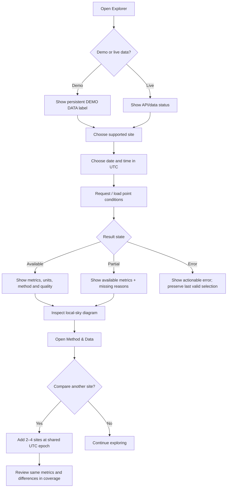
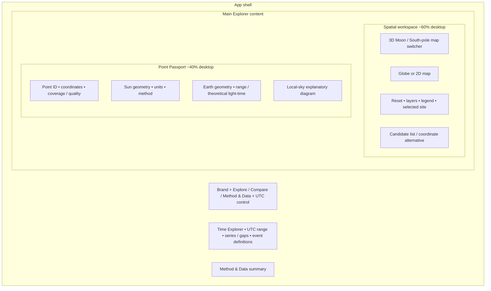
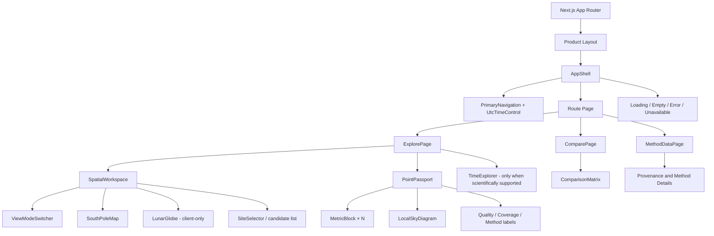
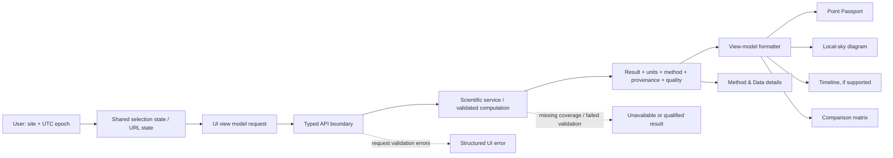
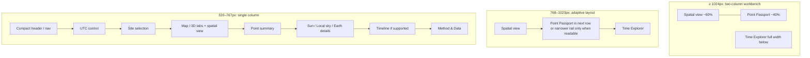
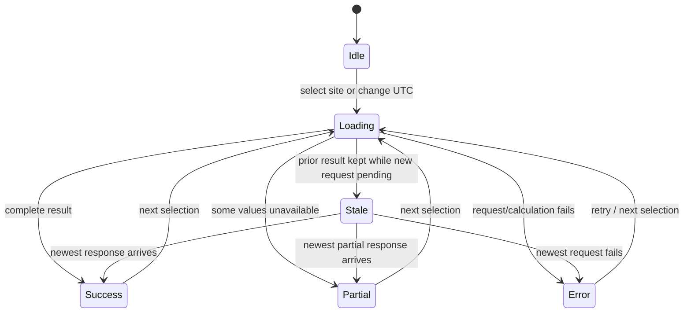
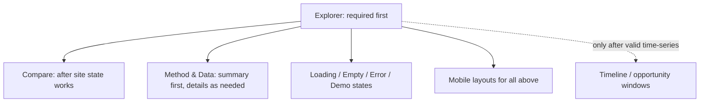

# LunaMission — UI/UX Diagrams

These diagrams are written in Mermaid so they remain editable in Markdown-capable environments and can be supplied directly to coding/design agents. They are structural references, not a claim that the science pipeline is already implemented.

## 1. User journey

## 2. Explorer screen regions

## 3. Component hierarchy

## 4. Data flow and trust boundary

**Boundary rule:** rendering may illustrate geometry, but must not become a competing source of truth for scientific values. Display components receive explicit values, units and quality state.

## 5. Responsive composition

## 6. Result-state behavior

## 7. Screen-by-screen prototype inventory

## Diagram conventions

- `Sun` is solar gold (`#F3CC70`); `Earth` is Earth blue (`#8CCBFF`); selected site is teal (`#70D6C5`).
- A dashed connector represents an optional/conditional capability or a boundary—not a completed scientific dependency.
- A `DEMO DATA` banner is a real UI state, not an annotation limited to a design preview.
